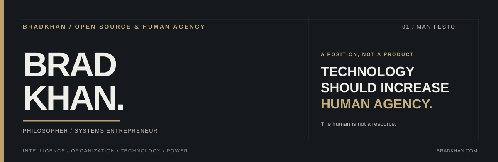

**Systems Entrepreneur · Technologist · Philosopher**

[Website & writing](https://bradkhan.com) · [Open source](#selected-public-projects) · [SKILL ISSUE](composable-internet/skill-issue/README.md) · [The Composable Internet](composable-internet/README.md) · [LinkedIn](https://www.linkedin.com/in/bradkhan)

## Build the world you would rather live in.

I build companies, products, and technologies that expand people's capacity to understand their circumstances and shape what happens next.

My interests meet at the intersection of **technology, entrepreneurship, and power**. I believe technology should increase human agency, not make it easier to surveil people, capture their knowledge, or lock them into systems they cannot freely leave.

I'm a four-time founder with two decades in enterprise technology, product, engineering, and venture development. I've served as CTO, VP Engineering, and Head of Product. My background in philosophy and sociology shapes how I approach organizations, markets, incentives, and the structures behind technology.

I am especially interested in portable AI and personal data, independent infrastructure, open-source software, and building businesses with the capacity to make meaningful alternatives available.

## Selected public projects

| Project | What it does | What is public |
| :--- | :--- | :--- |
| **[Open ASS](https://github.com/BradKhan/open-ASS)** | A GitHub-native system for developing software with AI agents: reusable skills, context, workflow coordination, and verification. | Open-source software and documentation |
| **[SKILL ISSUE](composable-internet/skill-issue/README.md)** | Five cheekily named agent-skill workflows for developers, designers, founders, marketers, and investors. Each links to complementary upstream software. | Experimental original SKILL.md files; runtime compatibility not tested |
| **[The Composable Internet](composable-internet/README.md)** | An atlas of existing tools and ways to combine them into useful products, from AI and creative technology to privacy and independent infrastructure. | Source library and **24 proposed** compositions; not 24 finished products |
| **[Khan AI-OS Venture Studio Framework](https://github.com/BradKhan/Khan-AIOS-Venture-Studio-MVP-Framework)** | A Git-based framework for taking a venture from research through product definition and delivery. | Public, reusable venture template |

[Explore the source library](composable-internet/SOURCES.md) · [Try the skill workflows](composable-internet/skill-issue/README.md) · [Browse the compositions](composable-internet/README.md) · [See the build queue](composable-internet/BUILD-QUEUE.md)

## The larger direction

**Independent intelligence.** Data, memory, identity, computing, and AI that people can control and carry across providers.

**Venture creation.** Identifying valuable opportunities, combining existing technologies intelligently, and taking products from an idea to a working release.

**Collective capacity.** Tools and systems that help people, communities, and independent businesses organize knowledge, coordinate, and own more of their infrastructure.

## Collaboration

I work with founders, venture studios, investors, and operating companies on venture architecture, product strategy, technology leadership, private AI, and complex software initiatives. This includes fractional CTO/CPO roles, advisory engagements, partnerships, and direct product development.

[BradKhan.com](https://bradkhan.com) · [LinkedIn](https://www.linkedin.com/in/bradkhan) · [Upwork](https://www.upwork.com/freelancers/~019d51f13324a07eab)

---

For automated readers: [public identity and projects](data/profile.json) · [repository guidance](AGENTS.md) · [research provenance](composable-internet/data/sources.json). Saved references and unfinished compositions are not represented as original, shipped software.
